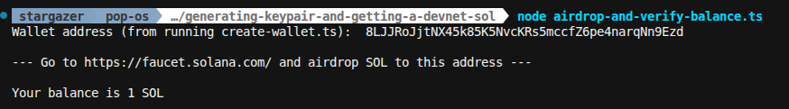

# Day 008 — Read your first on-chain data

- Date: 2026-10-18
- Challenge: [MLH Day 8](https://www.mlh.com/events/100-days-of-solana/challenges/019dce5b-1ba5-f91a-07c9-8c0b6430f857)
- Network: Devnet
- Code: [Balance lookup from Day 1](../../projects/generating-keypair-and-getting-a-devnet-sol/airdrop-and-verify-balance.ts)

## Goal

Read the SOL balance of a public devnet address with `@solana/kit`. No wallet
connection and no transaction.

## Setup and run

The challenge starter is the same RPC read already in the Day 1 balance script:
`createSolanaRpc(devnet("https://api.devnet.solana.com"))`, then
`getBalance(address(...)).send()`, then divide lamports by `1_000_000_000`.

That script loads the public address from a local `.env` file instead of
hardcoding it. From the project directory:

```sh
pnpm install
node airdrop-and-verify-balance.ts
```

Re-run on 2026-10-18:

```text
Wallet address (from running create-wallet.ts):  8LJJRoJjtNX45k85K5NvcKRs5mccfZ6pe4narqNn9Ezd

Your balance is 1 SOL
```

## What I learned

- A balance read is a public RPC call. The script sends the address and gets
  lamports back. It does not need the private key.
- Devnet here is the same endpoint as Day 1: `https://api.devnet.solana.com`.
- The returned `value` is lamports. Display SOL by dividing by
  `1_000_000_000`, which is the Day 3 conversion.
- The address queried is the Day 1 devnet wallet,
  `8LJJRoJjtNX45k85K5NvcKRs5mccfZ6pe4narqNn9Ezd`.

## Problems and fixes

No new script was required. The Day 1 file already matches the challenge's
`getBalance` call, including the lamport-to-SOL conversion.

## Evidence

Same devnet address and the same **1 SOL** balance as the Day 1 screenshot.
Re-running the script on 2026-10-18 printed that balance again.



## Reflection

Reading chain data is the balance half of Day 1, without generating a new
keypair or visiting the faucet. The address is enough because the account
data is public.

## Completion

- [x] Devnet balance read checked
- [x] Existing script and screenshot recorded
- [x] Progress tracker updated
