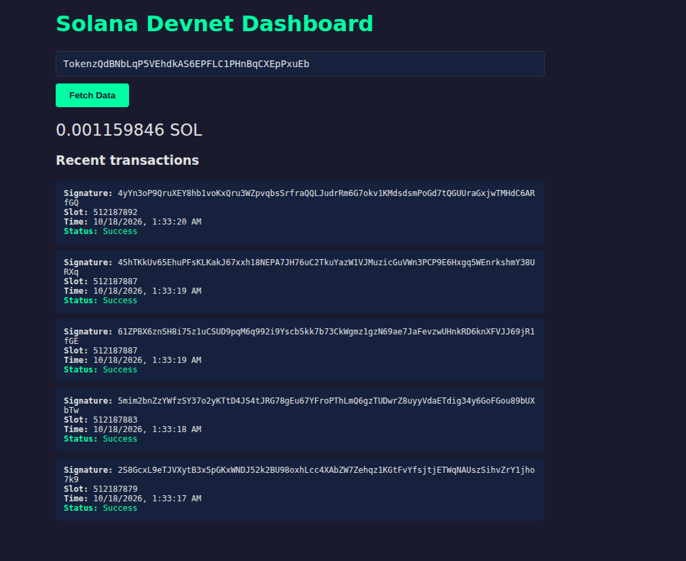

# Day 010 — Build a simple dashboard in the browser

- Date: 2026-10-18
- Challenge: [MLH Day 10](https://www.mlh.com/events/100-days-of-solana/challenges/019dd88a-06f0-928e-6075-2035a6de9a35)
- Network: Devnet
- Code: [Devnet dashboard](../../projects/devnet-dashboard/README.md)

## Goal

Show any devnet address's SOL balance and five newest transactions in a web
page, using the same RPC reads as Days 8 and 9.

## Setup and run

The page is a Vite app with `@solana/kit`. The markup and script follow the
challenge gists: an address field, a fetch button, and a results area. From
the project directory:

```sh
pnpm install
pnpm dev
```

The dev server for this check is **http://localhost:5174/**. The address field
starts as the Token-2022 program address,
`TokenzQdBNbLqP5VEhdkAS6EPFLC1PHnBqCXEpPxuEb`.

## What I learned

- The browser calls are the same as the terminal scripts: `getBalance` and
  `getSignaturesForAddress` on `https://api.devnet.solana.com`. Vite bundles
  `@solana/kit` so the page can import it.
- The page only sends a public address. It does not ask for a private key or
  a wallet connection.
- A bad string never reaches the RPC. `address()` rejects it first and the
  page prints that error in the page instead of crashing.
- The Token-2022 program account has a balance of its own. Looking it up
  showed **0.001159846 SOL** and five recent successful transactions. That
  balance is the account's lamports, separate from the token activity the
  program's code performs.
- The Day 1 wallet, `8LJJRoJjtNX45k85K5NvcKRs5mccfZ6pe4narqNn9Ezd`, still
  shows **1 SOL**. Its history is one successful transaction from
  2026-10-07, which matches the day that wallet was funded.

## Problems and fixes

The first fetch for Token-2022 rendered the balance and five transactions.
A second fetch for the Day 1 wallet replaced those results with 1 SOL and
one transaction. Entering `not-an-address` cleared the results and showed:
`Expected base58-encoded address string of length in the range [32, 44]. Actual length: 14.`

## Evidence

Checked in the browser on 2026-10-18 at http://localhost:5174/.

| Devnet address | Balance | Transactions shown |
| --- | --- | --- |
| `TokenzQdBNbLqP5VEhdkAS6EPFLC1PHnBqCXEpPxuEb` | 0.001159846 SOL | 5, all Success |
| `8LJJRoJjtNX45k85K5NvcKRs5mccfZ6pe4narqNn9Ezd` | 1 SOL | 1, Success, 2026-10-07 |

The saved screenshot shows the Token-2022 lookup: **0.001159846 SOL** and
five successful transactions from 2026-10-18, slots 512187879 through
512187892.



## Reflection

Days 8 and 9 answered a balance and a history question in the terminal. This
page asks both for whatever address is typed in. The program address and the
wallet address are both valid lookups, and they return different balances
and different histories.

## Completion

- [x] Dashboard fetches a balance and five transactions
- [x] A second address and an invalid address were checked
- [x] Screenshot saved
- [x] Progress tracker updated
